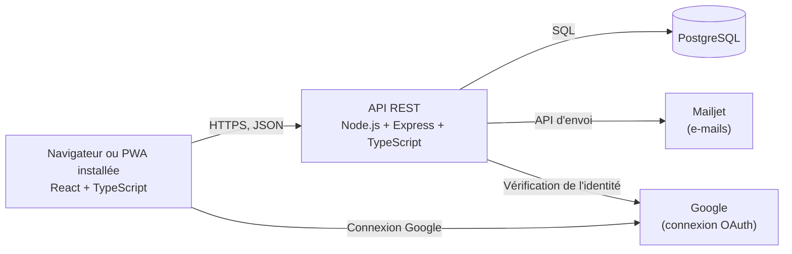

# Architecture et justification de la stack

## Table des matières

- [1. Objet et statut du document](#1-objet-et-statut-du-document)
- [2. Vue d'ensemble](#2-vue-densemble)
- [3. Contraintes qui guident les choix](#3-contraintes-qui-guident-les-choix)
- [4. Justification des choix](#4-justification-des-choix)
  - [4.1 TypeScript](#41-typescript)
  - [4.2 React](#42-react)
  - [4.3 PWA pour le mobile](#43-pwa-pour-le-mobile)
  - [4.4 Node.js](#44-nodejs)
  - [4.5 API REST avec Express](#45-api-rest-avec-express)
  - [4.6 PostgreSQL](#46-postgresql)
  - [4.7 Docker](#47-docker)
- [5. Organisation du code côté serveur](#5-organisation-du-code-côté-serveur)
- [6. Services externes](#6-services-externes)
- [7. Outils de test déjà en place](#7-outils-de-test-déjà-en-place)
- [8. Références](#8-références)

## 1. Objet et statut du document

Ce document explique pourquoi la stack de Lootopia a été retenue et comment ses composants s'articulent.

**La stack a été décidée par l'équipe lors du jalon 2** (réponses Q9 à Q12 de la synthèse du jalon 2) : React, Node, TypeScript, API Express, PostgreSQL, Docker, et PWA pour le mobile.

## 2. Vue d'ensemble



Le projet est organisé en deux applications TypeScript indépendantes, `frontend/` et `backend/`, qui communiquent uniquement par l'API REST. Tout est destiné à être lancé par `docker compose up`.

Le front-end ne porte pas les règles métier, la validation des étapes et la comparaison des réponses se font côté serveur.

## 3. Contraintes qui guident les choix

| Contrainte | Origine | Conséquence sur la stack |
| --- | --- | --- |
| Le Joueur utilise surtout un mobile, l'Organisateur surtout un ordinateur | Cahier des charges, section des rôles | Une seule interface qui s'adapte à tous les écrans |
| Pas d'application native, le web responsive suffit (PWA possible) | Cahier des charges, périmètre exclu | Choix d'une PWA |
| Aucune géolocalisation dans le MVP | Cahier des charges, exigences de sécurité et RGPD | Aucun besoin d'API native du téléphone |
| Un tiers installe et lance le prototype en moins de 15 minutes avec le seul README | Cahier des charges 5.5 et critère « Reproductibilité » (Q12) | Conteneurisation et lancement en une commande |
| Hébergement gratuit ou local, facile à déployer n'importe où | Q3 | Docker, aucune dépendance à un hébergeur particulier |
| Le code doit pouvoir être repris par une autre équipe | Cahier des charges, contrainte technique | Langage typé, code organisé, API documentée |
| Qualité prouvée par des tests, couverture d'au moins 70 % sur les modules critiques | Cahier des charges, critère « Qualité » | Écosystème de test des deux côtés |
| API REST documentée par Swagger (OpenAPI) | Q10 | Framework HTTP simple et complet |
| Une règle métier, un service côté serveur | Q11 | Architecture en services, indépendante du framework |
| Opérations atomiques de suppression de compte, de bannissement et de fermeture de chasse | Modèle de données, section 5 | Base relationnelle transactionnelle |
| Accessibilité WCAG 2.1 AA et Lighthouse accessibilité d'au moins 90 | Cahier des charges, section UX | Composants HTML maîtrisés côté front |

## 4. Justification des choix

### 4.1 TypeScript

**Rôle.** Langage unique du front-end et du back-end.

**Pourquoi.**

- Un seul langage pour toute l'équipe, ce qui simplifie les revues de code et permet à chaque membre d'intervenir des deux côtés.
- Le typage statique rend les règles du projet plus explicites : statuts d'une chasse (`draft`, `published`, `closing`, `closed`), de compte (`active`, `deleted`, `banned`) et de participation sont des ensembles de valeurs que le compilateur peut vérifier. Le modèle de données définit ces énumérations, elles se traduisent directement en types.
- La contrainte de reprise du code par une autre équipe est mieux servie par un code dont les entrées et sorties sont décrites par des types.
- Les outils de test sont déjà configurés pour TypeScript dans le dépôt (voir la section 7).
- Enfin, TypeScript est connu et plus ou moins maitrisé par tous les membres de l'équipe.

**Point d'attention.** Le typage n'existe qu'à la compilation. Les données reçues par l'API restent à valider à l'exécution : le choix de la bibliothèque de validation n'est pas encore fait (section 8).

### 4.2 React

**Rôle.** Construction de l'interface web.

**Pourquoi.**

- L'interface se décompose naturellement en composants réutilisables : liste de chasses, écran de jeu, éditeur d'étape, tableau de suivi des participants, formulaire de signalement. Le cahier des charges décrit plusieurs états pour un même écran (chargement, erreur, liste vide, chasse en fermeture), que l'architecture en composants gère bien.
- C'est une bibliothèque très répandue, avec un écosystème d'outils de test et d'accessibilité assez large.
- React s'intègre sans difficulté avec une PWA (voir 4.3) et avec TypeScript.
- Les outils de test des composants (React Testing Library) sont déjà installés dans le dépôt.

**Point d'attention.** React ne fournit pas à lui seul le routage, ni la gestion de l'état partagé. Ces choix complémentaires ne sont pas encore faits (section 8).

### 4.3 PWA pour le mobile

**Rôle.** Fournir une expérience mobile sans développer d'application native.

**Pourquoi.**

- Le MVP n'utilise aucune fonction native du téléphone, donc rien ne justifie le coût de développement d'une application native.
- Pas de mode hors-ligne pour l'application.
- Un seul code source pour mobile et ordinateur, un seul déploiement, aucune publication sur une boutique d'applications.

**Points d'attention.**

- Une PWA exige un accès HTTPS en production.

### 4.4 Node.js

**Rôle.** Environnement d'exécution du serveur.

**Pourquoi.**

- Permet d'écrire le serveur en TypeScript, donc d'avoir le même langage que le front-end (voir 4.1).
- Adapté à une API qui passe l'essentiel de son temps à attendre la base de données ou un service externe (Mailjet, Google), ce qui correspond à l'usage de Lootopia.
- Large écosystème de bibliothèques pour tout ce que le projet doit faire : accès à PostgreSQL, hachage de mots de passe, envoi d'e-mails, limitation de débit, tâches planifiées.
- Léger à conteneuriser avec Docker.

**Point d'attention.** Les opérations de calcul lourdes sont à éviter dans le serveur mais ce n'est pas un risque pour le MVP car les traitements prévus (comparaison d'une réponse normalisée, mise à jour d'un compteur de temps) sont légers.

### 4.5 API REST avec Express

**Rôle.** Exposer les services métier au front-end sous forme d'API REST.

**Pourquoi.**

- Express est un framework qui se limite au routage et aux middlewares. Cela permet d'organiser facilement le code et convient donc à la décision Q11 (« une règle métier, un service »), car les règles métier restent dans des services indépendants du framework HTTP, et les routes ne font que les appeler.
- Les mécanismes dont le projet a besoin se branchent comme des middlewares : authentification, contrôle des droits, limitation du débit des tentatives de réponse (Q16) et des envois d'e-mails.
- Les tests d'intégration de l'API sont déjà outillés avec Supertest (section 7). Un test doit en particulier parcourir toutes les réponses de l'API pour vérifier qu'aucune ne contient la réponse attendue d'une étape (Q23).

**Point d'attention.** Express impose très peu de structure donc l'organisation doit venir de l'équipe.

### 4.6 PostgreSQL

**Rôle.** Stockage des comptes, chasses, étapes, participations, tentatives, badges, signalements et jetons.

**Pourquoi.**

- Le modèle de données de Lootopia est relationnel : une chasse a des étapes, un joueur a des participations, une participation a des tentatives et au plus un badge. Les liens entre ces entités sont des clés étrangères.
- Les règles du modèle s'expriment directement en base (unicité d'une participation par couple chasse/joueur...).
- Les types dont le modèle a besoin sont natifs : identifiants `uuid`, dates avec fuseau `timestamptz`, énumérations pour les statuts.
- Les transactions sont indispensables. La suppression volontaire d'un compte et le bannissement sont chacun une suite d'opérations qui doit réussir ou échouer entièrement. Le modèle de données impose une transaction par service.
- La suppression en cascade est gérée par la base.
- Gratuit, ouvert et disponible dans une image Docker officielle, ce qui répond à la contrainte d'un lancement en une commande.

**Point d'attention.** L'outil d'accès à la base et l'outil de migrations ne sont pas encore choisis.

### 4.7 Docker

**Rôle.** Empaqueter et lancer l'ensemble du projet, avec `docker compose up`.

**Pourquoi.**

- C'est une exigence directe du cahier des charges : un tiers lance le prototype depuis zéro en moins de 15 minutes avec le seul README.
- L'hébergement retenu est gratuit ou local, facile à déployer n'importe où car un conteneur ne dépend d'aucun fournisseur.
- Le même environnement (version de Node.js, de PostgreSQL) pour tous les développeurs, pour la CI et pour la démonstration.
- La base PostgreSQL se lance dans un conteneur, sans installation sur la machine.
- Un serveur SMTP de test local peut être ajouté à la composition afin de ne jamais envoyer de vrai e-mail ni utiliser la clé Mailjet en développement ou en CI.

**Point d'attention.** L'instance de démonstration accessible à l'évaluateur n'a pas encore d'hébergeur désigné.

## 5. Organisation du code côté backend

Deux décisions d'équipe structurent le back-end, conformément aux règles de [CLAUDE.md](../CLAUDE.md) et au cahier des charges :

- **Une règle métier, un service (Q11).** Un tiers doit pouvoir retrouver où modifier une règle de progression. Les routes Express valident l'entrée, appellent un service et renvoient la réponse.
- **Un fichier, une responsabilité.** Chaque fichier et chaque fonction ont une seule responsabilité.

Pour l'organisation des dossiers, nous partons sur un dossier par feature avec un possible regroupement en domaine dans le cas d'une utilisation commune d'un repository (par exemple la gestion des comptes). Un dossier shared pour les modules partagés entre plusieurs features. Voici un exemple d'architecture correspondante : 

```
backend/
└── src/
    ├── app.ts
    ├── server.ts
    │
    ├── config/
    │   ├── env.ts
    │   ├── database.ts
    │   └── swagger.ts
    │
    ├── db/
    │   └── migrations/
    │
    ├── shared/
    │   ├── middleware/
    │   │   ├── authenticate.ts
    │   │   ├── requireRole.ts
    │   │   ├── rateLimiter.ts
    │   │   └── errorHandler.ts
    │   ├── services/
    │   │   ├── jwt.service.ts
    │   │   └── password.service.ts
    │   ├── types/
    │   │   ├── hunt.types.ts
    │   │   ├── account.types.ts
    │   │   └── participation.types.ts
    │   ├── errors/
    │   │   ├── AppError.ts
    │   │   ├── NotFoundError.ts
    │   │   ├── ForbiddenError.ts
    │   │   └── ValidationError.ts
    │   └── utils/
    │       ├── normalizeAnswer.ts
    │       └── pagination.ts
    │
    └── features/
        │
        ├── compte/                              
        │   ├── compte.repository.ts             
        │   ├── inscription/
        │   │   ├── inscription.router.ts
        │   │   ├── inscription.service.ts
        │   │   └── inscription.service.test.ts
        │   ├── connexion/
        │   │   ├── connexion.router.ts
        │   │   ├── connexion.service.ts
        │   │   └── connexion.service.test.ts
        │   ├── reinitialisation-mot-de-passe/
        │   │   ├── reinitialisation.router.ts
        │   │   ├── reinitialisation.service.ts
        │   │   └── reinitialisation.service.test.ts
        │   └── gestion/                         
        │       ├── gestion.router.ts
        │       ├── gestion.service.ts
        │       ├── gestion.service.test.ts
        │       └── gestion.router.test.ts
        │
        ├── jeton/                               
        │   ├── jeton.repository.ts
        │   └── jeton.service.ts
        │
        ├── email/
        │   ├── email.service.ts
        │   └── email.service.test.ts
        │
        ├── chasse/
        │   ├── chasse.repository.ts
        │   ├── chasse.router.ts
        │   ├── chasse.service.ts
        │   ├── chasse.service.test.ts
        │   └── chasse.router.test.ts
        │
        ├── etape/
        │   ├── etape.repository.ts
        │   ├── etape.router.ts
        │   ├── etape.service.ts
        │   ├── etape.service.test.ts
        │   └── etape.router.test.ts
        │
        ├── participation/
        │   ├── participation.repository.ts
        │   ├── participation.router.ts
        │   ├── participation.service.ts
        │   ├── participation.service.test.ts
        │   └── participation.router.test.ts
        │
        ├── tentative/
        │   ├── tentative.repository.ts
        │   ├── tentative.router.ts
        │   ├── tentative.service.ts
        │   ├── tentative.service.test.ts
        │   └── tentative.router.test.ts
        │
        ├── badge/
        │   ├── badge.repository.ts
        │   ├── badge.router.ts
        │   ├── badge.service.ts
        │   └── badge.service.test.ts
        │
        └── signalement/
            ├── signalement.repository.ts
            ├── signalement.router.ts
            ├── signalement.service.ts
            ├── signalement.service.test.ts
            └── signalement.router.test.ts
```

## 5. Organisation du code côté frontend

Un dossier par domaine ou feature, chaque feature découpée en sous-feature qui ont chacun leur page et leurs composants, et chaque composant isolé dans son propre dossier avec son CSS et son test.

```
frontend/
└── src/
    ├── app/
    │   ├── App.tsx
    │   ├── router.tsx
    │   └── providers.tsx
    │
    ├── shared/
    │   ├── components/
    │   │   └── Button/
    │   │       ├── Button.tsx
    │   │       ├── Button.module.css
    │   │       └── Button.test.tsx
    │   ├── hooks/
    │   │   └── useHttpClient.ts
    │   ├── types/
    │   └── utils/
    │
    └── features/
        └── compte/
            ├── api/
            │   └── compte.api.ts
            ├── hooks/
            │   └── useCompte.ts
            └── inscription/
                ├── InscriptionPage.tsx
                ├── InscriptionPage.module.css
                └── components/
                    └── FormulaireInscription/
                        ├── FormulaireInscription.tsx
                        ├── FormulaireInscription.module.css
                        └── FormulaireInscription.test.tsx
```

## 6. Services externes

| Service | Usage | Justification du choix | Limites à connaître |
| --- | --- | --- | --- |
| Mailjet | E-mails transactionnels : confirmation d'adresse, mot de passe oublié, prévenance de fermeture d'une chasse, information de bannissement | Solution gratuite, hébergée, qui gère la sécurité de l'envoi et est hébergée dans l'UE (Q2) | Offre gratuite limitée à 200 e-mails par jour et 6 000 par mois. Le fournisseur voit le contenu des e-mails, d'où des jetons à usage unique et de courte durée. |
| Google | Connexion par compte Google (OAuth) | Facilité de connexion pour les utilisateurs et sécurité gérée par google | La connexion par e-mail et mot de passe reste disponible, aucune solution de remplacement n'est nécessaire. |

Conditions de mise en oeuvre retenues pour Mailjet : clé d'API dans une variable d'environnement, permissions réduites à l'envoi, authentification à deux facteurs sur le compte. Les identifiants OAuth Google ne sont jamais fournis à l'IA (politique d'usage de l'IA).

## 7. Outils de test déjà en place

Le dépôt contient déjà la configuration suivante (voir les fichiers `package.json` de `backend/` et `frontend/`) :

| Côté | Outils |
| --- | --- |
| Back-end | Jest, ts-jest, Supertest |
| Front-end | Jest, ts-jest, React Testing Library|

Les tests s'exécutent par `npm test` à la racine. Le détail se trouve dans [Structure des tests](tests/structure-des-tests.md) et [Pipelines CI](ci/pipelines.md).

## 8. Références

- [Cahier des charges](cadrage/cahier-des-charges.md)
- [Journal des décisions](cadrage/journal-des-decisions.md)
- [Analyse des risques](cadrage/analyse-des-risques.md)