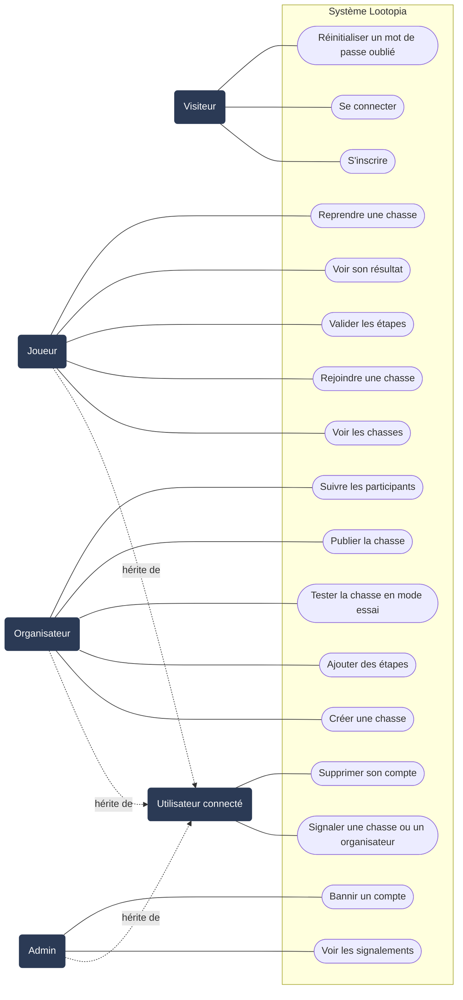
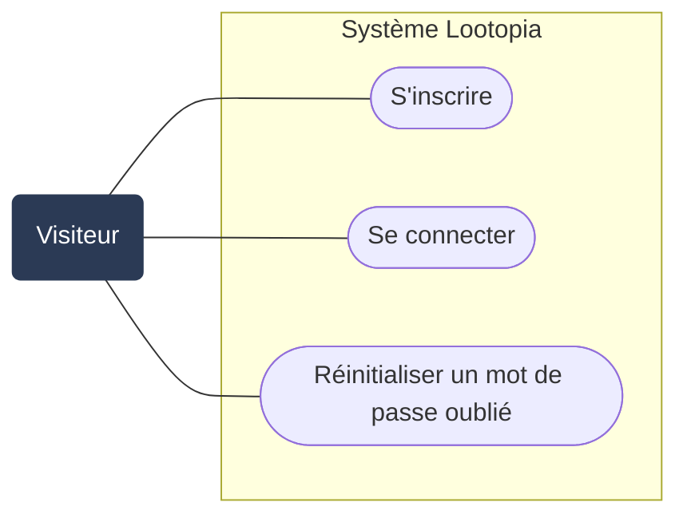
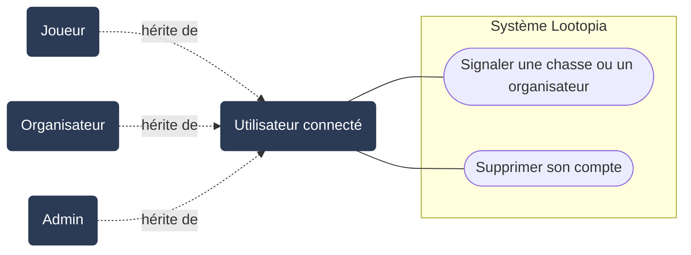
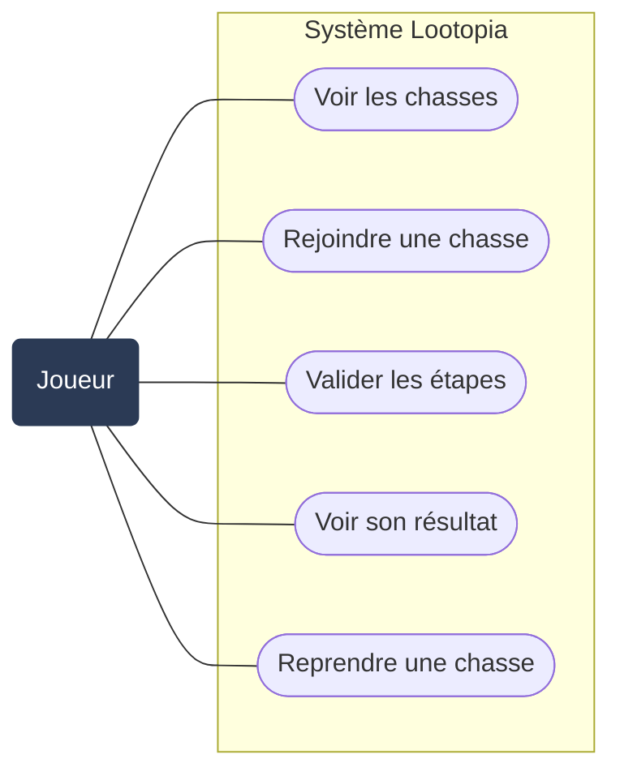
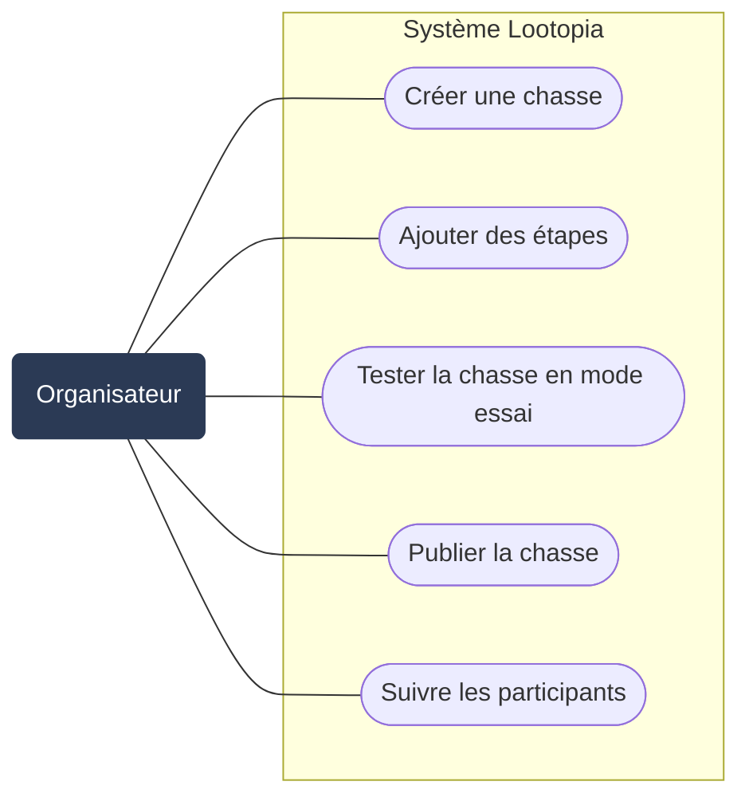
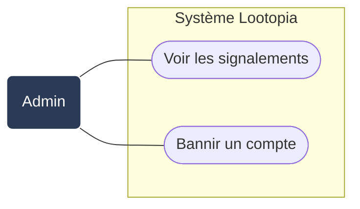
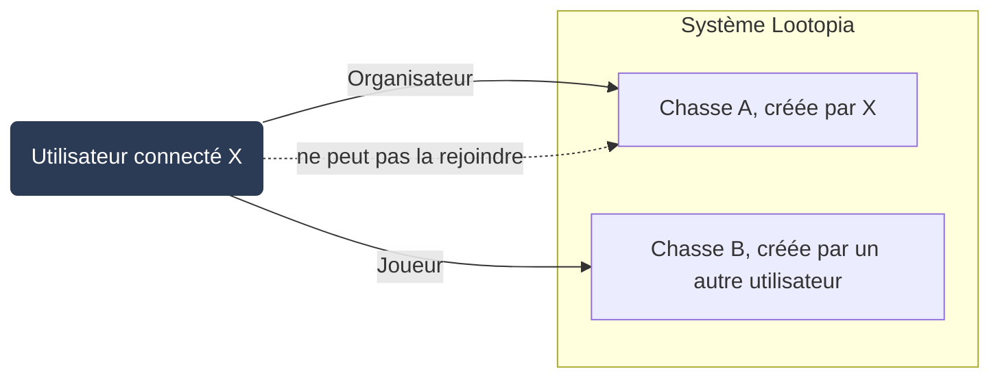

# Diagrammes de cas d'usage - Lootopia

| | |
| --- | --- |
| **Document** | Diagrammes de cas d'usage, Lootopia (MVP) |
| **Version** | 0.1 (brouillon) |
| **Date** | 27/11/2026 |
| **Statut** | À relire et valider par l'équipe |
| **Documents liés** | [Cahier des charges](../cadrage/cahier-des-charges.md), [Journal des décisions](../cadrage/journal-des-decisions.md) |

Ce document décrit ce que chaque acteur peut faire dans l'application. Il s'appuie sur la section 2 (acteurs, rôles et permissions), la section 3.2 (règles métier) et la section 4 (spécifications fonctionnelles) du cahier des charges. Les identifiants `US-x.y` et `RMx` renvoient à ce document.

Déclaration d'usage de l'IA : ce document a été rédigé avec l'aide de Claude (Anthropic) à partir du cahier des charges et de la liste des acteurs fournie par l'équipe. Il est à relire et valider par l'équipe.

## Table des matières

- [1. Acteurs](#1-acteurs)
- [2. Lecture des diagrammes](#2-lecture-des-diagrammes)
- [3. Vue d'ensemble](#3-vue-densemble)
- [4. Diagrammes par acteur](#4-diagrammes-par-acteur)
  - [4.1 Visiteur](#41-visiteur)
  - [4.2 Utilisateur connecté](#42-utilisateur-connecté)
  - [4.3 Joueur](#43-joueur)
  - [4.4 Organisateur](#44-organisateur)
  - [4.5 Admin](#45-admin)
- [5. Double rôle Joueur et Organisateur](#5-double-rôle-joueur-et-organisateur)
- [6. Points à valider](#6-points-à-valider)

## 1. Acteurs

| Acteur | Description | Nature |
| --- | --- | --- |
| Visiteur | Personne non connectée. | Absence de session |
| Utilisateur connecté | Toute personne authentifiée, quel que soit son type de compte. | Session active |
| Joueur | Utilisateur connecté qui a rejoint une chasse. | Rôle par chasse (RM2, RM10) |
| Organisateur | Utilisateur connecté qui a créé une chasse. | Rôle par chasse (RM1, RM10) |
| Admin | Utilisateur connecté dont le compte est de type Admin. Ce type n'est jamais proposé à l'inscription. | Type de compte (section 2) |

Il n'existe pas de rôle global Joueur ou Organisateur. Un même utilisateur est Organisateur des chasses qu'il a créées et Joueur des chasses qu'il a rejointes (RM10). Ce rôle par chasse s'applique aussi à un Admin (section 2 du cahier des charges).

## 2. Lecture des diagrammes

Les diagrammes sont écrits en Mermaid, qui n'a pas de type « cas d'usage » natif. La notation UML est donc reproduite ainsi :

| Élément UML | Représentation |
| --- | --- |
| Acteur | Rectangle aux coins arrondis, fond foncé |
| Cas d'usage | Forme ovale (stade) |
| Frontière du système | Cadre « Système Lootopia » |
| Association acteur et cas d'usage | Trait plein |
| Généralisation entre acteurs | Flèche en pointillés libellée « hérite de », de l'acteur spécialisé vers l'acteur général |

Un acteur spécialisé peut réaliser tous les cas d'usage de l'acteur général. Par exemple, un Joueur est un Utilisateur connecté, il peut donc signaler une chasse ou supprimer son compte.

## 3. Vue d'ensemble

## 4. Diagrammes par acteur

### 4.1 Visiteur

| Cas d'usage | Description et règles | Référence |
| --- | --- | --- |
| S'inscrire | Création d'un compte avec pseudo, e-mail et mot de passe, ou via Google. Aucun rôle à choisir. Le message « un e-mail est envoyé » s'affiche que l'adresse soit déjà utilisée ou non. Un lien de confirmation de l'e-mail est envoyé. | US-1.1, US-1.5 |
| Se connecter | Connexion par e-mail et mot de passe, ou via Google. Message générique si les identifiants sont invalides. Un compte supprimé ou banni ne peut pas se connecter. | US-1.2 |
| Réinitialiser un mot de passe oublié | Demande par e-mail, lien à usage unique et à durée limitée. La réponse ne confirme pas l'existence du compte. Toutes les sessions actives sont invalidées après la réinitialisation. | US-1.6 |

### 4.2 Utilisateur connecté

Ces cas d'usage sont accessibles à toute personne connectée, donc aussi au Joueur, à l'Organisateur et à l'Admin par généralisation.

| Cas d'usage | Description et règles | Référence |
| --- | --- | --- |
| Signaler une chasse ou un organisateur | Motif obligatoire. Aucune action automatique sur la chasse ou le compte signalé : le traitement est manuel, par un Admin. | US-7.1 |
| Supprimer son compte | Confirmation explicite avec un avertissement sur ce qui sera perdu. Suppression définitive, en tout ou rien. Les conséquences sur les chasses et les participations suivent RM11. | US-1.4, RM11 |

### 4.3 Joueur

| Cas d'usage | Description et règles | Référence |
| --- | --- | --- |
| Voir les chasses | Liste paginée des chasses publiées (20 par page) et détail d'une chasse. Aucun brouillon, aucune chasse privée, en fermeture ou fermée dans la liste. Le détail n'affiche jamais le contenu des étapes ni les réponses. | US-2.1, US-2.2 |
| Rejoindre une chasse | Impossible sur sa propre chasse (403). Une seule participation par joueur et par chasse, une chasse terminée ne se rejoue pas (409). Une chasse privée se rejoint uniquement par son lien ou son code d'invitation. Une chasse en fermeture ne peut plus être rejointe. | US-4.1, RM2, RM14, RM15 |
| Valider les étapes | Seule l'étape courante est visible. Les étapes se valident dans l'ordre. La comparaison se fait côté serveur, la réponse attendue n'est jamais envoyée au navigateur. Une mauvaise réponse ne change pas l'état et ne verrouille pas le joueur. | US-4.2, US-4.3, US-4.5, RM5, RM6, RM9 |
| Voir son résultat | La validation de la dernière étape termine la participation. Le récapitulatif affiche le temps total, les étapes franchies, le nombre d'essais et le badge. Il reste consultable plus tard. | US-5.1, US-5.2, RM7 |
| Reprendre une chasse | Après une déconnexion, le joueur retrouve l'étape courante exacte. L'état est conservé côté serveur. | US-4.4 |

### 4.4 Organisateur

| Cas d'usage | Description et règles | Référence |
| --- | --- | --- |
| Créer une chasse | Création en brouillon avec un titre (3 à 100 caractères) et une description (jusqu'à 1 000 caractères). Le créateur devient l'Organisateur de la chasse. | US-3.1, RM1 |
| Ajouter des étapes | Chaque étape a un titre, une consigne, une réponse attendue et une position. Ordre modifiable et suppression possible tant que la chasse est en brouillon. Les étapes ne sont plus modifiables après la publication. | US-3.2, RM8 |
| Tester la chasse en mode essai | Uniquement sur une chasse en brouillon dont il est l'Organisateur. Parcours identique à celui d'un Joueur, sans participation ni résultat enregistré. | US-3.5, RM13 |
| Publier la chasse | Refusée sans titre ou sans étape. Publication possible en mode privé avec un code d'invitation de 6 caractères. Date de fermeture optionnelle, en heure de Paris. | US-3.3, US-3.6, US-3.7, RM4, RM14, RM15 |
| Suivre les participants | Liste des participants de ses propres chasses : pseudo, étape atteinte, statut, date de début, temps total si terminé. Filtre par statut et compteurs. 403 sur la chasse d'un autre. | US-6.1, US-6.2 |

### 4.5 Admin

| Cas d'usage | Description et règles | Référence |
| --- | --- | --- |
| Voir les signalements | Liste des signalements : chasse ou compte signalé, motif, auteur, date. 403 pour un compte qui n'est pas de type Admin. | US-7.2 |
| Bannir un compte | Confirmation explicite. Bannissement définitif, le compte ne peut plus se connecter. Un e-mail est envoyé à chaque joueur dont une participation en cours est supprimée. Les autres conséquences suivent RM12. | US-7.3, RM12 |

## 5. Double rôle Joueur et Organisateur

Joueur et Organisateur ne sont pas des types de compte mais des rôles portés sur une chasse. Le diagramme ci-dessous montre un même utilisateur qui organise une chasse A et joue une chasse B créée par quelqu'un d'autre.

Règles associées :

- Créer une chasse rend son créateur Organisateur de cette chasse uniquement (RM1).
- Rejoindre une chasse rend l'utilisateur Joueur de cette chasse uniquement (RM2).
- Un Organisateur ne peut pas rejoindre sa propre chasse (US-4.1, réponse 403).
- Un Admin peut aussi être Organisateur ou Joueur, selon les mêmes règles (section 2 et matrice 2.1 du cahier des charges).

## 6. Points à valider

Ces points ne sont pas tranchés par le cahier des charges ou sortent de la liste des cas d'usage fournie. Ils sont à valider par l'équipe.

| Réf. | Point | Question |
| --- | --- | --- |
| CU-1 | Suppression du compte par un Admin | La matrice 2.1 ne dit pas si un Admin peut supprimer son propre compte. Le diagramme le permet par généralisation. Faut-il l'interdire, par exemple s'il est le dernier Admin ? |
| CU-2 | Cas d'usage du cahier absents de la liste | Le cahier décrit aussi : se déconnecter (US-1.2), confirmer son e-mail (US-1.5), accéder à « Mes chasses » et « Mes participations » (US-1.3), voir la liste de ses chasses (US-3.4). Faut-il les ajouter comme cas d'usage à part entière ? |
| CU-3 | Acteur des cas « Rejoindre une chasse » et « Créer une chasse » | Au sens strict, c'est un Utilisateur connecté qui rejoint ou crée une chasse, et il en devient Joueur ou Organisateur à ce moment. Les diagrammes suivent la répartition fournie par l'équipe. Faut-il rattacher ces deux cas à l'Utilisateur connecté ? |
