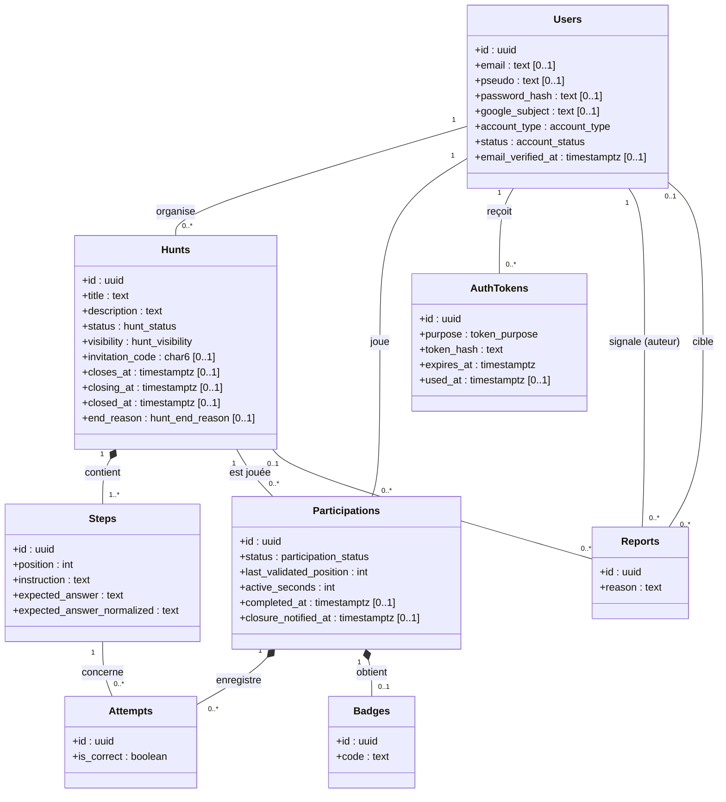
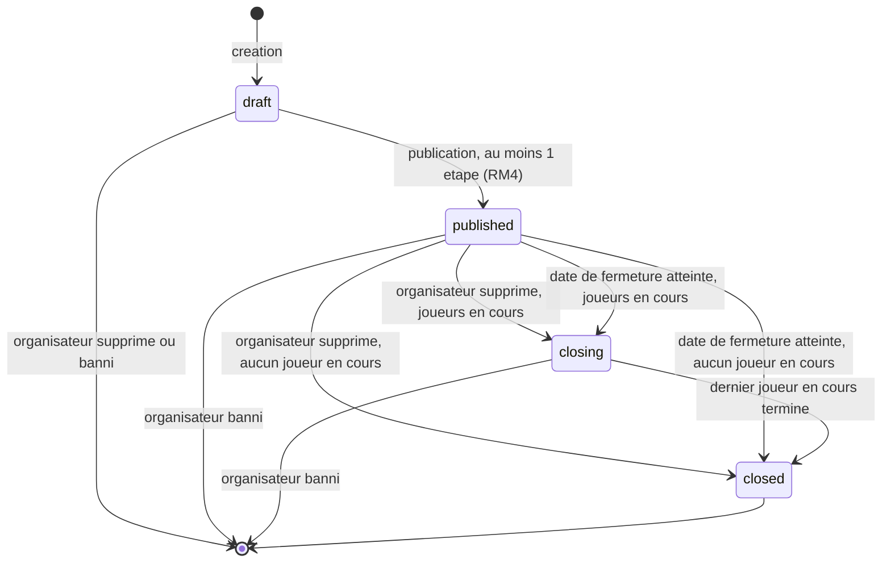
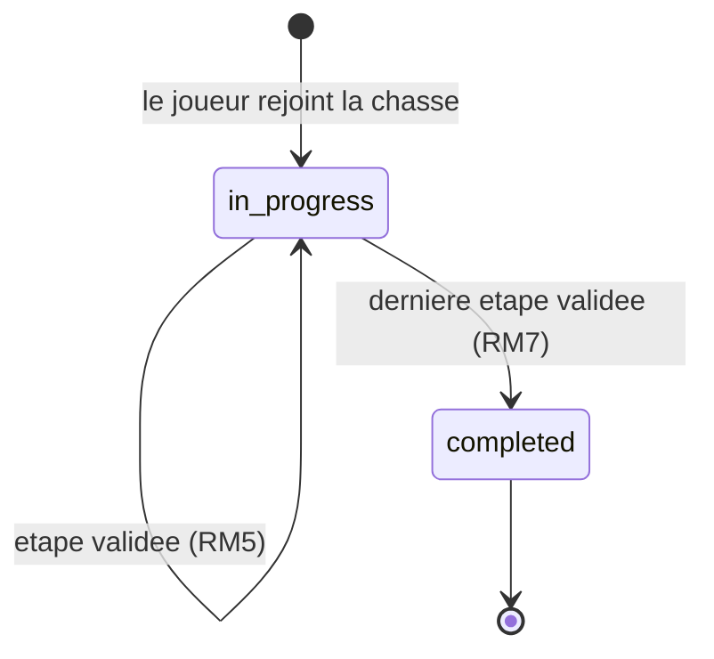
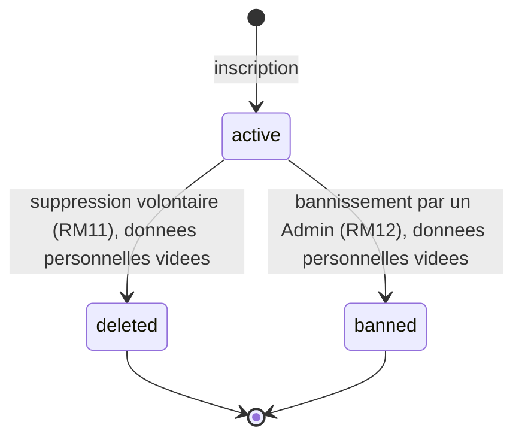

# Modèle de données - Lootopia

| | |
| --- | --- |
| **Document** | Modèle de données, Lootopia (MVP) |
| **Version** | 0.2 (brouillon) |
| **Date** | 29/10/2026 |
| **Statut** | Proposition à valider par l'équipe, référent Données et sécurité |
| **Documents liés** | [Synthèse des réponses du jalon 2](synthese-reponses-jalon-2.md), [Cahier des charges](../cadrage/cahier-des-charges.md), [schema.sql](../../deploiement/sql/schema.sql) |

Ce document décrit le modèle de données proposé pour répondre au cahier des charges v1.4 et aux décisions du 29/10/2026.

Déclaration d'usage de l'IA : Le squelette de ce modèle de données à été rédigé par l'IA en se basant sur le cahier des charges afin d'avoir une base puis il a été retravaillé entièrement par l'équipe.

## 1. Principes globaux

- **Aucune suppression physique de compte :** Une suppression volontaire ou un bannissement change le statut du compte (`deleted` ou `banned`) et vide ses données personnelles. L'identifiant, non personnel, reste en base. Cela permet d'afficher « compte supprimé » sur la chasse encore ouverte.
- **Deux sorties différentes :** À la suppression d'un compte initiée par un utilisateur lui même, ses chasses publiées restent ouvertes jusqu'à la fin des participations en cours, puis se ferment (statuts `closing` puis `closed`). Au bannissement, les chasses du compte et toutes leurs participations sont supprimées.
- **Fermeture par date, même mécanique que la suppression volontaire :** Quand la date de fermeture optionnelle est dépassée, une tâche planifiée fait passer la chasse en `closing` s'il reste des participations en cours, ou directement en `closed` sinon, exactement comme pour une suppression volontaire. Contrairement à la suppression volontaire, aucun e-mail n'est envoyé aux joueurs en cours car la date était connue à l'avance.
- **Une participation par joueur et par chasse :** Un joueur ne peut pas rejouer une chasse.
- **Identifiants UUID :** Unicité nécessaire pour les besoins de Lootopia.
- **Dates en UTC :** La date de fermeture d'une chasse est interprétée dans le fuseau `Europe/Paris` par l'application.
- **Aucune saisie de joueur stockée :** Une tentative enregistre seulement l'étape, la date et le résultat.
- **Réponse attendue :** Stockée en clair pour que l'Organisateur la relise en brouillon, avec sa forme normalisée pour la comparaison. Elle ne sort jamais de l'API.
- **Positions d'étape non renumérotées à la suppression :** Supprimer une étape en brouillon peut laisser un trou dans la séquence (ex. 1, 3 après suppression de la position 2). Plutôt que de renumeroter, l'étape courante d'une participation se retrouve par la plus petite position strictement supérieure à la dernière validée.
- **Signalements :** Un signalement vise soit une chasse, soit un compte, jamais les deux en même temps.

## 2. Diagramme de classes (UML)

Le modèle est représenté en UML par un diagramme de classes. Chaque classe correspondra à une table dans la base de données.

Lecture du diagramme :

- Une association porte sa multiplicité à chaque extrémité : `1`, `0..1`, `0..*` ou `1..*`.
- Un losange plein indique une composition. Les étapes disparaissent avec leur chasse, les tentatives et le badge avec leur participation.
- Un attribut marqué `[0..1]` peut être nul. Les autres sont obligatoires.
- Les clés étrangères sont portées par les associations.
- Les types en minuscules et avec des tirets bas (`hunt_status`, par exemple) sont des énumérations, listées plus bas.

### 2.1 Énumérations

| Type | Valeurs |
| --- | --- |
| `account_type` | `user`, `admin` |
| `account_status` | `active`, `deleted`, `banned` |
| `hunt_status` | `draft`, `published`, `closing`, `closed` |
| `hunt_visibility` | `public`, `private` |
| `hunt_end_reason` | `owner_deleted`, `closing_date_reached` |
| `participation_status` | `in_progress`, `completed` |
| `token_purpose` | `email_confirmation`, `password_reset` |

## 3. Entités

| Entité | Rôle | Points de conception | Règles liées |
| --- | --- | --- | --- |
| `users` | Compte | E-mail unique sans tenir compte de la casse. Mot de passe haché, nul pour un compte Google. `google_subject` identifiant unique côté Google. Type de compte `user` ou `admin`, statut `active`, `deleted` ou `banned`. Un compte supprimé ou banni n'a plus aucune donnée personnelle. | US-1.1, RM11, RM12, Q1, Q6 |
| `auth_tokens` | Jetons de confirmation d'e-mail et de réinitialisation | Seul le hachage du jeton est stocké. Expiration et date d'utilisation pour l'usage unique. | US-1.5, US-1.6, Q2 |
| `hunts` | Chasse | Propriétaire jamais nul. Statut `draft`, `published`, `closing` (participations en cours à terminer) ou `closed`, avec `end_reason` qui distingue une suppression d'organisateur (`owner_deleted`) d'une date de fermeture atteinte (`closing_date_reached`). Un bannissement ne passe jamais par `closed` : la chasse est supprimée. Chasse privée : code de 6 caractères majuscules et chiffres, obligatoire si privée, interdit si publique. Date de fermeture optionnelle (`closes_at`), surveillée par une tâche planifiée qui déclenche la même mécanique de fermeture que RM11. | RM1, RM3, RM14, RM15, Q5, Q18 |
| `steps` | Étape | Position unique par chasse. Pas renumérotée à la suppression d'une étape. Réponse attendue et sa forme normalisée. | RM5, RM6, RM8, RM9, US-3.2 |
| `participations` | Participation d'un joueur | Unique par (chasse, joueur). `last_validated_position` est la position de la dernière étape validée (0 si aucune) : l'étape courante est la plus petite position de `steps` strictement supérieure à cette valeur, la progression est écrite à chaque validation. Aucun résultat à cette recherche signifie que la chasse est terminée (RM7). Temps de jeu en secondes, compteur mis à jour par le serveur pendant que le joueur joue, figé à la fin. Date d'envoi de l'e-mail de prévenance de fermeture. | RM2, RM7, Q4, Q5, Q15, US-4.x |
| `attempts` | Tentative de réponse | Étape, date, réussite. Pas de saisie brute. Sert au nombre d'essais du récapitulatif et à la limitation. | US-4.3, US-5.2, Q16 |
| `badges` | Badge de complétion | Table dédiée, une ligne par participation et par code.. | US-5.1 |
| `reports` | Signalement | Une cible, chasse ou compte. Motif obligatoire. | US-7.1, US-7.2 |

## 4. Diagrammes d'états

### 4.1 Chasse

### 4.2 Participation

Il n'y a pas de retour de `completed` vers `in_progress` : une chasse ne se rejoue pas.

### 4.3 Compte

## 5. Suppression de compte et bannissement

Les deux opérations ont des effets différents et restent deux services applicatifs distincts, chacun dans une seule transaction.

**Suppression volontaire (RM11, Q5)**, dans une transaction :

1. Relever les joueurs ayant une participation en cours sur les chasses publiées du compte
2. Vider e-mail, pseudo, mot de passe et identifiant Google, passer le statut à `deleted` et renseigner `deleted_at`.
3. Supprimer les brouillons du compte.
4. Passer ses chasses publiées à `closing`, ou directement à `closed` s'il n'y a aucune participation en cours.
5. Supprimer ses propres participations de joueur, puis vérifier les chasses `closing` dont il était le dernier joueur en cours : elles passent à `closed`.
6. Supprimer ses jetons en attente et fermer ses sessions.
7. Après validation de la transaction, envoyer l'e-mail de prévenance aux joueurs relevés et renseigner `closure_notified_at`.

Plus tard, quand la dernière participation en cours d'une chasse `closing` se termine (RM7), le service de validation d'étape passe la chasse à `closed`.

**Bannissement (RM12, Q6)**, dans une transaction :

1. Relever les joueurs ayant une participation en cours sur les chasses du compte banni.
2. Vider les données personnelles du compte, passer le statut à `banned` et renseigner `banned_at`.
3. Supprimer toutes les chasses du compte : leurs étapes, toutes leurs participations (celles des autres joueurs comprises), essais, badges et signalements partent en cascade.
4. Supprimer ses propres participations de joueur, puis vérifier les chasses `closing` d'autres comptes dont il était le dernier joueur en cours.
5. Après validation, envoyer l'e-mail aux joueurs relevés à l'étape 1.

L'identifiant du compte banni reste dans les signalements qui le visaient. Comme l'adresse e-mail n'est plus conservée, la personne bannie peut se réinscrire avec la même adresse. C'est une conséquence de l'anonymisation.

**Fermeture par date de fermeture atteinte (RM15)**, par une tâche planifiée (fréquence à définir, l'index `hunts_closes_at_idx` sert à cette recherche) :

1. Sélectionner les chasses `published` dont `closes_at` est dépassé.
2. Pour chacune, relever ses participations en cours.
3. Passer la chasse à `closing` (avec `end_reason = closing_date_reached` et `closing_at` à l'heure du traitement) s'il en reste, ou directement à `closed` (avec `closed_at`) sinon.

Contrairement à la suppression volontaire, aucun e-mail n'est envoyé car la date de fermeture était fixée par l'Organisateur et connue à l'avance des joueurs. Comme pour la suppression volontaire, le passage ultérieur de `closing` à `closed` est pris en charge par le service de validation d'étape quand la dernière participation en cours se termine (RM7), quel que soit `end_reason`.

## 6. Règles de l'application

Ces règles ne s'expriment pas simplement en base mais aussi par les services :

- RM2 : un joueur ne rejoint pas sa propre chasse.
- RM4 : publication seulement avec au moins une étape et un titre.
- RM5, RM6, RM9 : validation des étapes dans l'ordre côté serveur avec une comparaison normalisée. Étape courante : `SELECT MIN(position) FROM steps WHERE hunt_id = ... AND position > last_validated_position`. Aucun résultat : dernière étape déjà validée, la participation passe à `completed` (RM7).
- RM8 : les étapes d'une chasse publiée ne sont plus modifiées.
- RM13 : le mode essai ne crée aucune participation.
- RM15 : une tâche planifiée (cron/job) fait passer en `closing` ou `closed` une chasse publiée dont la date de fermeture est dépassée, de sorte qu'elle n'est plus proposée à de nouveaux joueurs.
- Limitation des essais de réponse et des envois d'e-mails.

## 7. Points à définir

- Durée maximale d'une chasse `closing` si un joueur ne termine jamais
- Fréquence de la tâche planifiée qui détecte les dates de fermeture dépassées
