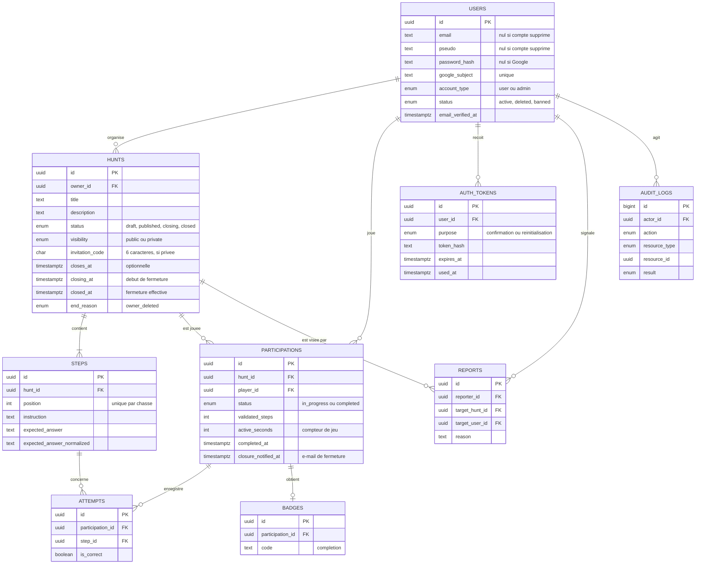
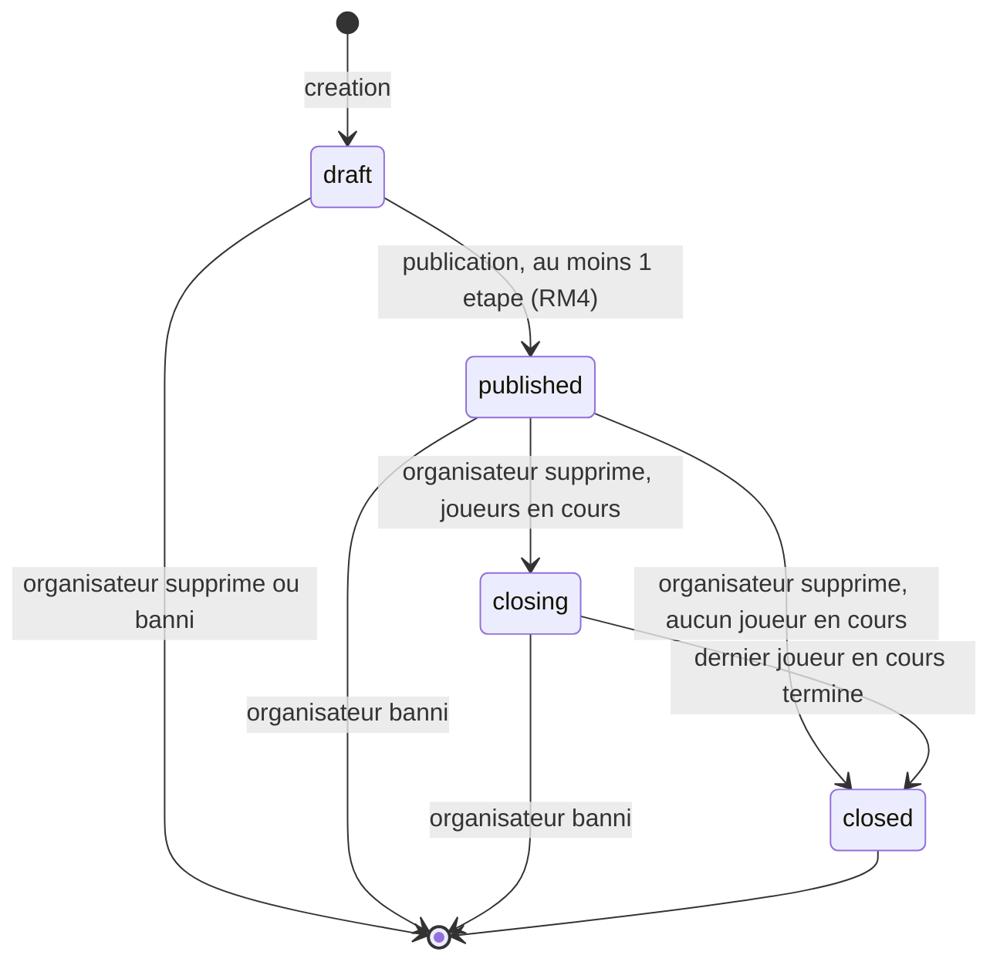
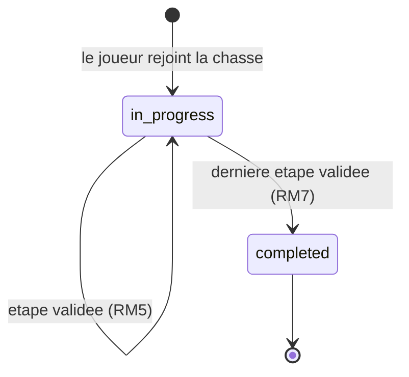
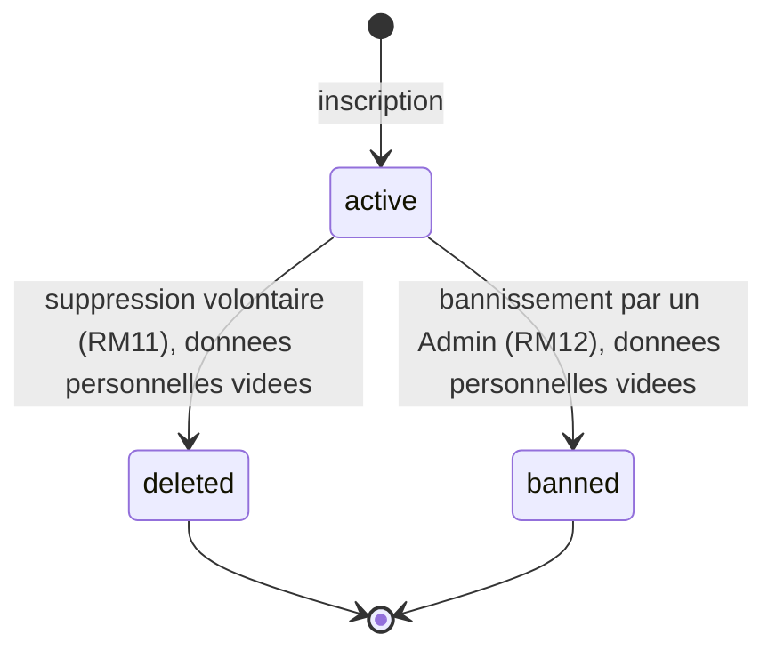

# Modèle de données - Lootopia

| | |
| --- | --- |
| **Document** | Modèle de données, Lootopia (MVP) |
| **Version** | 0.1 (brouillon) |
| **Date** | 26/10/2026 |
| **Statut** | Proposition à valider par l'équipe, référent Données et sécurité |
| **Documents liés** | [Synthèse des réponses du jalon 2](synthese-reponses-jalon-2.md), [Cahier des charges](../cadrage/cahier-des-charges.md), [schema.sql](schema.sql) |

Ce document décrit le modèle de données proposé pour répondre au cahier des charges v1.1 et aux décisions du 26/10/2026. Les neuf entités ont été acceptées « pour l'instant » par l'équipe. Le script [schema.sql](schema.sql) est la traduction en PostgreSQL : il a été chargé sur PostgreSQL 16 et ses contraintes ont été essayées avec des données fictives (rejeu refusé, chasse privée sans code refusée, compte supprimé avec données personnelles refusé, etc.).

Déclaration d'usage de l'IA : rédigé avec l'aide de Claude (Anthropic). Selon la politique d'usage de l'IA, le choix final est pris et justifié par l'équipe dans le journal des décisions, et le script n'est exécuté que par un humain sur une base locale.

## 1. Principes

- **Aucune suppression physique de compte.** Une suppression volontaire (RM11) ou un bannissement (RM12) change le statut du compte (`deleted` ou `banned`) et vide ses données personnelles. L'identifiant, non personnel, reste en base. Cela permet d'afficher « compte supprimé » sur la chasse encore ouverte (Q5), de garder le journal avec l'identifiant du compte (Q6) sans donnée personnelle, et d'anonymiser l'acteur sans modifier le journal (TR-3).
- **Deux sorties différentes.** À la suppression volontaire, les chasses publiées restent ouvertes jusqu'à la fin des participations en cours, puis se ferment (statuts `closing` puis `closed`). Au bannissement, les chasses du compte et toutes leurs participations sont supprimées.
- **Une participation par joueur et par chasse**, quel que soit son statut (Q4) : pas de rejeu.
- **Identifiants UUID** non devinables, car une ressource d'autrui répond 403 et non 404 (Q7).
- **Dates en UTC.** La date de fermeture d'une chasse est interprétée dans le fuseau `Europe/Paris` par l'application (Q17).
- **Aucune saisie de joueur stockée.** Une tentative enregistre seulement l'étape, la date et le résultat (TR-1).
- **Réponse attendue** stockée en clair pour que l'Organisateur la relise en brouillon (US-3.2), avec sa forme normalisée (RM9) pour la comparaison. Elle ne sort jamais de l'API (RM6, Q23).

## 2. Diagramme entité-relation

## 3. Entités

| Entité | Rôle | Points de conception | Règles liées |
| --- | --- | --- | --- |
| `users` | Compte | E-mail unique sans tenir compte de la casse. Mot de passe haché, nul pour un compte Google. Type de compte `user` ou `admin`, statut `active`, `deleted` ou `banned`. Un compte supprimé ou banni n'a plus aucune donnée personnelle (contrainte en base). | US-1.1, RM11, RM12, Q1, Q6 |
| `auth_tokens` | Jetons de confirmation d'e-mail et de réinitialisation | Seul le hachage du jeton est stocké. Expiration et date d'utilisation pour l'usage unique. | US-1.5, US-1.6, Q2 |
| `hunts` | Chasse | Propriétaire jamais nul. Statut `draft`, `published`, `closing` (organisateur supprimé, participations en cours à terminer) ou `closed`. Chasse privée : code de 6 caractères majuscules et chiffres, obligatoire si privée, interdit si publique. Date de fermeture optionnelle, comparée à l'heure courante sans changer le statut. | RM1, RM3, RM14, RM15, Q5, Q18 |
| `steps` | Étape | Position unique par chasse, contrainte différée pour permettre le réordonnancement dans une transaction. Réponse attendue et sa forme normalisée. | RM5, RM6, RM8, RM9, US-3.2 |
| `participations` | Participation d'un joueur | Unique par (chasse, joueur). Nombre d'étapes validées : l'étape courante est la suivante, la progression est écrite à chaque validation. Temps de jeu en secondes, compteur mis à jour par le serveur pendant que le joueur joue, figé à la fin. Date d'envoi de l'e-mail de prévenance de fermeture. | RM2, RM7, Q4, Q5, Q15, US-4.x |
| `attempts` | Tentative de réponse | Étape, date, réussite. Pas de saisie brute. Sert au nombre d'essais du récapitulatif et à la limitation. | US-4.3, US-5.2, Q16 |
| `badges` | Badge de complétion | Table dédiée, une ligne par participation et par code. Prépare les badges supplémentaires (Could). | US-5.1 |
| `reports` | Signalement | Exactement une cible, chasse ou compte. Motif obligatoire. | US-7.1, US-7.2 |
| `audit_logs` | Journal des actions sensibles | Horodatage, acteur, action, ressource, résultat. Acteur nul pour un visiteur anonyme. Pour un bannissement, la ressource est l'identifiant du compte concerné, conservé. Aucune donnée personnelle. | TR-1, TR-3, Q6 |

Les sessions ne sont pas modélisées : elles dépendent du choix entre session côté serveur et jeton, pas encore tranché.

## 4. Diagrammes d'états

Ces diagrammes mettent à jour ceux validés en Q13 pour tenir compte de Q5, Q6 et Q21.

### 4.1 Chasse

Une chasse `closing` n'accepte plus de nouveau joueur et reste jouable par ceux qui l'ont commencée. Elle prévient ses joueurs en cours par e-mail de sa fermeture prochaine (Q5). La date de fermeture optionnelle (RM15) ne crée pas d'état : une chasse publiée dont `closes_at` est dépassée n'est plus proposée aux nouveaux joueurs, mais les participations en cours restent possibles. Au bannissement de l'organisateur, la chasse est supprimée avec ses étapes et ses participations, depuis n'importe quel état (Q6).

### 4.2 Participation

Il n'y a pas de retour de `completed` vers `in_progress` : une chasse ne se rejoue pas (Q4).

### 4.3 Compte

## 5. Suppression de compte et bannissement

Les deux opérations ont des effets différents et restent deux services applicatifs distincts, chacun dans une seule transaction (tout ou rien, US-1.4). Elles ont été essayées sur le schéma avec des données fictives (voir [schema.sql](schema.sql)).

**Suppression volontaire (RM11, Q5)**, dans une transaction :

1. Relever les joueurs ayant une participation en cours sur les chasses publiées du compte : ils recevront l'e-mail de prévenance.
2. Vider e-mail, pseudo, mot de passe et identifiant Google, passer le statut à `deleted` et renseigner `deleted_at`.
3. Supprimer les brouillons du compte (personne d'autre ne peut les voir).
4. Passer ses chasses publiées à `closing`, ou directement à `closed` s'il n'y a aucune participation en cours.
5. Supprimer ses propres participations de joueur, puis vérifier les chasses `closing` dont il était le dernier joueur en cours : elles passent à `closed`.
6. Supprimer ses jetons en attente et fermer ses sessions.
7. Après validation de la transaction, envoyer l'e-mail de prévenance et renseigner `closure_notified_at`.

Le journal n'est pas modifié : l'acteur est déjà un identifiant non personnel (TR-3). Plus tard, quand la dernière participation en cours d'une chasse `closing` se termine (RM7), le service de validation d'étape passe la chasse à `closed`.

**Bannissement (RM12, Q6)**, dans une transaction :

1. Relever les joueurs ayant une participation en cours sur les chasses du compte banni.
2. Vider les données personnelles du compte, passer le statut à `banned` et renseigner `banned_at`.
3. Supprimer toutes les chasses du compte : leurs étapes, toutes leurs participations (celles des autres joueurs comprises), essais, badges et signalements partent en cascade.
4. Supprimer ses propres participations de joueur, puis vérifier les chasses `closing` d'autres comptes dont il était le dernier joueur en cours.
5. Écrire l'entrée de journal : action `account_ban`, acteur l'Admin, ressource l'identifiant du compte banni.
6. Après validation, envoyer l'e-mail aux joueurs relevés à l'étape 1, comme le prévoit RM12 [maintien de cet e-mail non confirmé par l'équipe, voir la synthèse].

L'identifiant du compte banni reste dans le journal et dans les signalements qui le visaient. Comme l'adresse e-mail n'est plus conservée, la personne bannie peut se réinscrire avec la même adresse : c'est une conséquence de l'anonymisation.

## 6. Règles portées par l'application

Ces règles ne s'expriment pas simplement en base et sont portées par les services côté serveur (une règle, un service, Q11) :

- RM2 : un joueur ne rejoint pas sa propre chasse.
- RM4 : publication seulement avec au moins une étape et un titre.
- RM5, RM6, RM9 : validation des étapes dans l'ordre, côté serveur, comparaison normalisée.
- RM8 : les étapes d'une chasse publiée ne sont plus modifiées.
- RM13 : le mode essai ne crée aucune participation.
- RM15 : une chasse dont la date de fermeture est dépassée n'est plus proposée à de nouveaux joueurs.
- Limitation des essais de réponse et des envois d'e-mails (Q16, point P4 de la synthèse).

## 7. Points ouverts

- Voir les points P6, P7 et P9 de la [synthèse des réponses](synthese-reponses-jalon-2.md), ainsi que le maintien de l'e-mail aux joueurs en cas de bannissement.
- Brouillon d'un compte supprimé : le script prévoit de le supprimer, puisque personne d'autre ne peut le voir. C'est une proposition, à valider par l'équipe.
- Durée maximale d'une chasse `closing` si un joueur ne termine jamais : non définie (point P9).
- Outil d'accès à la base et de migrations : à choisir avec la stack. Ce script en est le point de départ, il n'est pas la migration finale.
